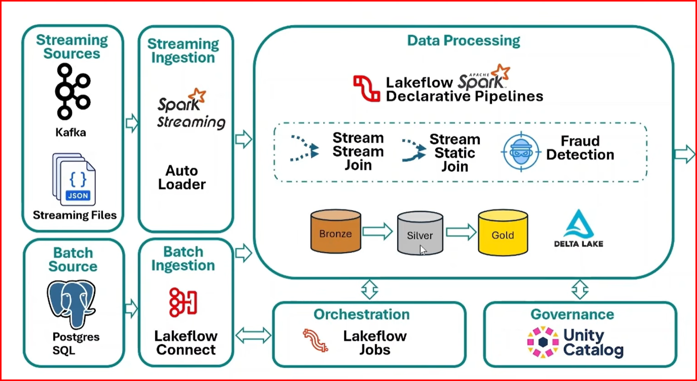
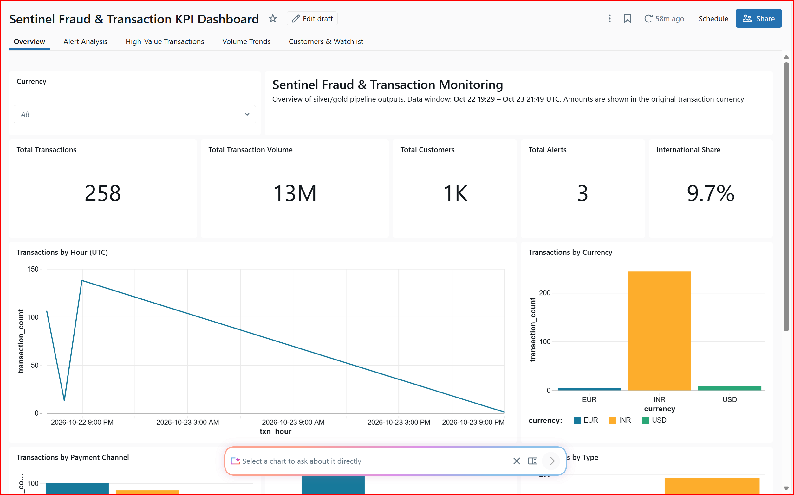

# Sentinel Bank — End-to-End Spark Streaming Project

**Databricks + Kafka + PostgreSQL + Real-Time Dashboard**

> A real-time fraud detection pipeline for a fictional bank, **Sentinel Bank**, built on Azure Databricks with Lakeflow Spark Declarative Pipelines, Delta Lake (medallion architecture), and Unity Catalog governance.
>
> 🖼️ Project screenshots: https://github.com/saipriya8990/Sentinel_Streaming_Project/tree/main/Images

---

## 📌 The Business Problem

Sentinel Bank processes **millions of credit card transactions every day** — across ATMs, POS terminals, and online payment gateways.

At the same time, the bank receives a **continuous stream of fraud intelligence** from its internal fraud teams and external security partners.

The problem:

- Fraudulent transactions must be identified **within seconds**, not hours.
- Fraud indicators arrive from **multiple sources** — live transactions, fraud watchlists, and customer master data.
- Traditional **batch processing cannot react quickly enough** to stop fraud before the money moves.

Delayed fraud detection means real financial losses for the bank and a poor experience for customers.

## 💡 The Solution

Build a **real-time streaming pipeline** that:

1. **Ingests live credit card transactions from Kafka** (Confluent Cloud) using Spark Structured Streaming.
2. **Continuously processes fraud watchlist updates** arriving as JSON files (Auto Loader) and enriches transactions with customer and merchant reference data.
3. **Applies streaming joins, window-based analytics, and fraud detection rules** to generate alerts and feed an operational dashboard — all within seconds of a transaction happening.

## 🏛️ Architecture



## 🖼️ Screenshots

**The streaming pipeline**


**Catalog & tables (Bronze → Silver → Gold)**


**Fraud alert in action**


**The dashboard**



*The full set of screenshots — jobs, ETL pipelines, source data, and more alerts — stays in the `Images` folder for reference.*

| Layer | What happens here |
|---|---|
| **Streaming Sources** | Kafka (transactions + fraud data), JSON streaming files (watchlist updates) |
| **Batch Source** | PostgreSQL (customer master data) |
| **Streaming Ingestion** | Spark Streaming (Kafka) + Auto Loader (JSON files) |
| **Batch Ingestion** | Lakeflow Connect (PostgreSQL → Bronze) |
| **Data Processing** | Lakeflow Spark Declarative Pipelines — stream-stream joins, stream-static joins, fraud detection rules |
| **Storage** | Delta Lake, medallion architecture: **Bronze → Silver → Gold** |
| **Orchestration** | Lakeflow Jobs |
| **Governance** | Unity Catalog |

## 🛠️ Services Used

| Service | Purpose |
|---|---|
| **Confluent Cloud (Kafka)** | Sample streaming data — transactions and fraud data |
| **Neon PostgreSQL** | Sample customer master database (customer table) |
| **Azure Databricks** | Lakeflow Spark Declarative Pipelines, Lakeflow Jobs, Delta Lake |
| **Unity Catalog** | Data governance across Bronze, Silver, and Gold |

## 📥 Source Data

- **Kafka (Confluent Cloud):** sample data created for **transactions** and **fraud** streams.
- **PostgreSQL (Neon):** sample database created with a **customer** table.

## 🔄 Pipeline Stages

### 1. Source → Bronze (Ingestion)

- **Batch ingestion pipeline:** imports customer master data from PostgreSQL into Bronze.
- **Streaming pipeline:** continuously reads transactions and fraud-related data from Confluent Cloud (Kafka).

**Tables created in Bronze:**

```
sentinel.bronze.customers
sentinel.bronze.transactions
sentinel.bronze.fraud_watchlist
```

### 2. Bronze → Silver (Cleansing & Quality)

An ETL pipeline applies **transformations and data quality checks** and writes the cleaned, validated data from Bronze to Silver.

**Tables created in Silver:**

```
sentinel.silver.customers
sentinel.silver.transactions
sentinel.silver.fraud_watchlist
```

### 3. Silver → Gold (Business Aggregates & Alerts)

A further ETL pipeline filters Silver down to **only the data the business needs** — alerts and KPIs — and writes the Gold layer.

**Tables created in Gold:**

```
sentinel.gold.fraud_card_alert
sentinel.gold.high_value_transactions_alert
sentinel.gold.transaciton_count_by_minute
sentinel.gold.transaciton_count_by_minute_sliding_window
```

> Note: the last two table names keep the spelling exactly as created in the project.

## ⚙️ Orchestration (Lakeflow Jobs)

**Customers:**

- A job loads data end to end: **"Sentinel_Customers_Ingestion"** ingestion pipeline (PostgreSQL → Bronze table) → **"Sentinel_Customers_Silver_load"** ETL pipeline (Bronze → Silver).

**Transactions and fraud watchlist data:**

- ETL pipelines carry the data end to end: **Bronze → Silver → Gold → Alert**.

## 📊 Dashboard

The Gold tables feed the real-time dashboard:

> **"Sentinel Fraud & Transaction KPI Dashboard"**

It visualizes fraud card alerts, high-value transaction alerts, and transaction counts (per minute and sliding window) — giving the bank's operations team a live view of what is happening right now.

## 🧠 What This Project Demonstrates

- Real-time ingestion with **Kafka + Spark Structured Streaming** and **Auto Loader**
- Batch ingestion from **PostgreSQL with Lakeflow Connect**
- **Stream-stream and stream-static joins** for enriching live transactions
- **Window-based aggregations** (tumbling and sliding windows)
- **Rule-based fraud detection** producing actionable alerts
- **Medallion architecture** (Bronze → Silver → Gold) on Delta Lake
- End-to-end orchestration with **Lakeflow Jobs** and governance with **Unity Catalog**
- A **real-time KPI dashboard** built directly on Gold tables

## 📂 Repository Contents

- `Databricks/Sentinel_Project/` — Databricks notebooks and pipeline definitions
- `PostgreSQL_Input_Data/` — sample customer input data
- `kafka_producer/` — Kafka producer code for the sample transaction and fraud streams
- `Images/` — architecture diagram and screenshots of the pipelines, jobs, tables, alerts, and dashboard
- This README — full project explanation

## ⚠️ Disclaimer

**Sentinel Bank is a fictional bank created for learning purposes.** All data used in this project is sample data. Nothing here represents a real financial institution or real customer transactions.
